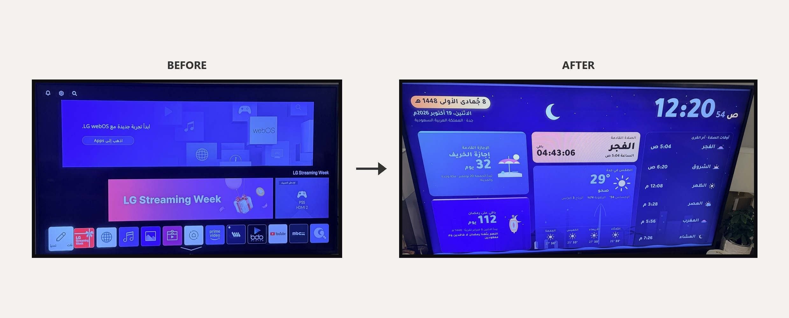

# شاشة البيت

[الرابط](https://mjn707.github.io/tv-dashboard/) · [البرومبت](PROMPT.md) · [الرخصة](LICENSE)

شاشة لتلفزيون البيت فيها:
- الساعة
- أوقات الصلاة حسب تقويم أم القرى
- الطقس
- عداد للإجازة الدراسية الجاية
- عداد لرمضان

الرابط:

https://mjn707.github.io/tv-dashboard/

## طريقة التركيب
1. افتح متصفح الإنترنت في التلفزيون، واكتب الرابط.
2. اضغط زر (OK) في الريموت عشان تصير ملء الشاشة.
3. اختر مدينتك والتقويم الدراسي والخلفية من زر الإعدادات ⚙ اللي جنب التاريخ. توصل له بالأسهم، وتفتحه بزر (OK).

## الخصوصية والأمان
- ما فيها تسجيل دخول ولا حسابات، ولا كوكيز ولا أدوات تتبّع أو إحصائيات.
- الشي الوحيد اللي تحفظه هو إعداداتك: المدينة والتقويم والخلفية. تنحفظ في متصفح تلفزيونك بس، وما توصل لأحد.
- تتصل بخدمات عامة بس:
  - (api.aladhan.com) لأوقات الصلاة.
  - (api.open-meteo.com) للطقس.
  - (thesportsdb.com) لموعد مباراة فريقك، وهذي بس إذا اخترت فريق.

  ترسل لخدمة الصلاة وخدمة الطقس إحداثيات المدينة اللي اخترتها، مو موقعك الدقيق. وترسل لخدمة المباريات رقم الفريق بس.
- الخط محفوظ داخل الموقع نفسه، وما يُحمّل من أي خدمة خارجية.
- الصفحة مقفلة بسياسة أمان المحتوى، يعني ما تقدر تشغّل أي كود من برّا الموقع ولا تتصل بأي جهة غير الخدمات اللي فوق.
- كل البيانات اللي توصل من هالخدمات تنفحص قبل ما تنعرض. والإعدادات المحفوظة والرابط ما يُقبل منهم إلا القيم المعروفة.

## سوّها بنفسك
تبي نسخة خاصة فيك، أو تعدّل عليها مع (Claude Code)؟ انسخ البرومبت من ملف [PROMPT.md](PROMPT.md) والصقه له. فيه الخطوات كلها والمشاكل اللي واجهناها وحلولها.

## الرخصة
الكود مرخّص بـ (MIT)، تقدر تاخذه وتعدّل عليه وتنشره، بشرط تبقي ملف [LICENSE](LICENSE) معه.

الخط: (Tajawal) من (Boutros Fonts)، مرخّص بـ (SIL Open Font License 1.1).
